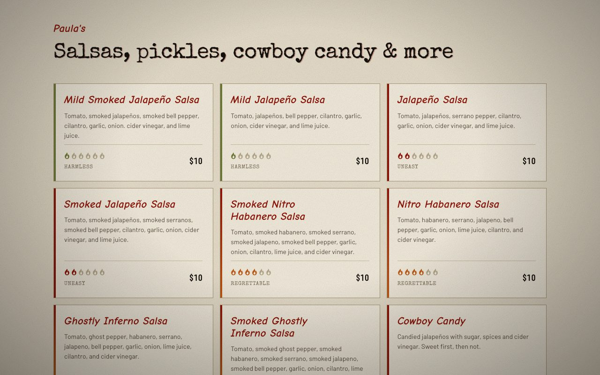

# Paula and Crazy John's Hot Stuff

[](https://github.com/rwickliffe/hotstuff/actions/workflows/check.yml)

**A storefront that two market sellers keep current from a spreadsheet, with no developer and no deploy.**

[paulaandcrazyjohn.com](https://paulaandcrazyjohn.com) is the website for a small-batch salsa, hot sauce, cowboy candy, pickle and chow chow maker in Elgin, Texas, who sell at farmers markets and community events.



## The problem

Stock turns over with the garden and the season, and the market schedule changes weekly. Paula and Crazy John aren't developers, and the site can't go stale waiting for one. So everything that changes often is handled in apps they already use:

| What                           | Changes      | Who updates it | Where                          |
| ------------------------------ | ------------ | -------------- | ------------------------------ |
| Product list, prices, sold out | Often        | Them           | A Google Sheet                 |
| Market and event schedule      | Weekly       | Them           | The same sheet, second tab     |
| Announcements                  | Now and then | Them           | The same sheet, third tab      |
| How-to videos                  | Now and then | Them           | The same sheet, fourth tab     |
| News                           | Weekly       | Them           | Facebook                       |
| Photos, story, layout          | Rarely       | A developer    | This repo                      |

## How it works

1. **Paula edits the sheet.** Each tab is published as CSV.
2. **A Cloudflare Worker fetches it.** An hourly cron, or a request that finds the data cold or stale, stores the rows in KV.
3. **Astro renders from KV.** Pages are built on the Worker for each request, with a short HTML cache in front. The browser never talks to Google.

Ordering and payment happen on Square, so the site never takes money. The contact form and newsletter run through the same Worker and Resend.

Built with Astro, Cloudflare Workers and KV, Resend, TypeScript, and Playwright.

## Decisions

- **A bad edit leaves the site stale, not broken.** A tab with the wrong columns, or an address that returns HTML instead of CSV, is refused and the last good data stays. If KV is empty, pages fall back to a committed snapshot. Adding `?debug` to any URL shows where each dataset came from.
- **It works without JavaScript.** Every jar, heat rating and price is in the HTML. Controls that need script stay hidden until it runs, and the contact form offers the phone number instead.
- **Third parties load only when chosen.** Video cards are poster frames that link out to YouTube rather than embeds, and the content security policy admits images from this site and YouTube's thumbnail host only.
- **The owners hold everything the site runs on.** The sheet, domain, Cloudflare and Resend are their accounts, so nothing in the live data path depends on the developer.
- **Previews can't touch live data.** A branch preview gets its own KV namespace, rate-limit counters, metrics dataset and copy of the sheet, and `./check` fails if a production ID is copied in.
- **The newsletter waits for consent.** Double opt-in is built, and it stays off until the mailing list lives in their Resend account, because a CSV export carries addresses but not the record of opting in.
- **The next project can reuse the generic part.** `src/lib/` knows nothing about this business and `src/domain/` is all about it, so a similar site keeps one and replaces the other.

## How it's checked

`./check` is one command that needs no network. It type-checks the pages and the Worker, runs the unit tests, and confirms the build works, the generated art is current, and the content security policy matches in both places it's set. Playwright then clicks through the real stack under `wrangler dev`: the heat filter, the "Ask for this" flow, and `?debug`. CI runs both on every push, on a different Node version from development so that runtime drift shows up.

The browser script ships exactly as it's written, with its types in JSDoc comments, so there's no build step between the repo and the page. Turning that type check on found real bugs, including a `Date` used as a number and a null guard one call site away from throwing.

## Running it

You need Node 22.23.4 or later.

```bash
npm ci
npm run build && npx wrangler dev   # the site and mail API, on one origin
./check
npx playwright test                 # first run: npx playwright install chromium
```

## Docs

- [The Google Sheet](docs/sheet.md): tabs, columns, publishing, and how to see what the Worker read
- [Development](docs/development.md): images, page behavior, checks, generated art, code layout, deploys, and previews
- [Operations](docs/operations.md): hosting, metrics, mail, and the plan to move the catalog to Square

## Status

The site is live and the contact form is delivering. The draft ribbon at the top of each page is deliberate: product names and ingredients were read off jar labels, and it stays until the owners confirm them. Remaining work is in the [issues](https://github.com/rwickliffe/hotstuff/issues).

<sub>Built by [Russell Wickliffe](https://github.com/rwickliffe) for Paula and Crazy John.</sub>
